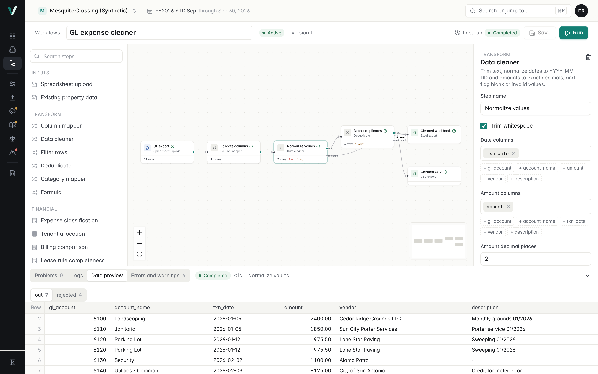

# Workflows

Workflows are saved, versioned graphs of steps that turn spreadsheets and Veyra property data into reviewed workbooks. Users build them on a canvas, run them with new files, review row-level errors, approve gated steps and download the outputs. Every run records the exact definition, input files (by SHA-256), step logs, issues and outputs.

The engine is scoped to CAM accounting work. It is not a general automation platform: there are no webhooks, no third-party connectors and no user code.



## Concepts

| Term | Meaning |
| --- | --- |
| Workflow | A named graph owned by an organization. Status draft, active or archived. |
| Version | An immutable copy of the definition. Saving creates a new version only when nodes, edges, configuration or layout changed. Runs always point at the version they executed. |
| Node (step) | One registered step type with configuration. See the catalog below. |
| Edge | Connects an output port of one step to an input port of another. |
| Run | One execution of a version with specific input files. |
| Step run | One node's execution inside a run: status, attempts, logs, output previews, issues, error. |
| Issue | A row-level finding (error, warning or info) with code, message, source row, column and value. Issues do not stop a run. |
| Artifact | A file a run produced: `output` (downloadable workbook or CSV) or `step_data` (internal, a step's full output table, used for previews and for resuming after an approval). |
| Approval | A pending, approved or rejected decision on an approval gate, with reviewer and note. |

## Architecture

```
frontend/app/(app)/workflows/          library, builder ([id]), run detail (runs/[runId])
frontend/components/workflows/         canvas node, config form, run dialog, data preview, issue list
backend/app/routers/workflows.py       REST API (organization scoped)
backend/app/workflows/
  table.py      data contract, spreadsheet parsing, CSV/XLSX export with injection protection
  expr.py       restricted Decimal formula language
  nodes.py      node registry and node implementations
  graph.py      normalization, validation, cycle detection, dependency order, hashing
  engine.py     run creation, execution, approvals, cancellation
  templates.py  the five built-in templates
backend/alembic/versions/0003_workflows.py
```

No new services. Runs execute in a FastAPI background task inside the API process, against PostgreSQL. This suits the single-dyno deployment; see Limits for when to move to a worker.

### Data contract

Every edge carries a `Table`: ordered column names, rows of text values, and for each row the source row number in the original sheet (header is row 1), or none for rows a step created. Values stay text so no number passes through a float. Steps that compute parse with `Decimal`, round half up, and write canonical text (`1234.50`). Dates are normalized to `YYYY-MM-DD`.

### Database

Migration `0003` adds `workflows`, `workflow_versions`, `workflow_nodes`, `workflow_edges`, `workflow_runs`, `workflow_step_runs`, `workflow_artifacts`, `workflow_approvals` and `workflow_templates`. Every organization-owned table has `organization_id`. Node and edge rows duplicate the version's JSON definition so versions can be queried without parsing JSON. Uploaded files reuse the existing immutable `source_files` table and are never overwritten.

## Execution semantics

1. **Create.** `POST /workflows/{id}/runs` validates the current version (graph and configuration), checks that every upload step has a file owned by the organization, then creates the run (`queued`) and one `pending` step run per node in dependency order. An `Idempotency-Key` header returns the existing run instead of creating a second one.
2. **Claim.** The background task claims the run with `UPDATE ... WHERE status = 'queued'`. A run is never executed twice in parallel.
3. **Order.** Steps run in topological order (Kahn). Ties keep the order of the definition, so the same definition always runs in the same order. Cycles are rejected at validation.
4. **Each step.** Inputs are loaded from upstream outputs (memory, or the stored `step_data` artifact after a resume). The node runs. Then status, logs, issues (capped at 2,000 per step), a 50-row preview per output port, the full output tables and any output files are committed together.
5. **Failure.** A configuration or input problem (`NodeError`) fails the step with its message. An unexpected exception fails it with a generic message; details go to the server log only. The first failed step fails the run and every later step is marked `skipped`. A run can never end `completed` with a failed step.
6. **Retries.** A step's `retries` setting (0 to 2) re-runs it after unexpected exceptions only. Invalid input is not retried: it would fail the same way. A whole run can be retried with `POST /workflow-runs/{id}/retry`, which creates a new run of the same version with the same files and links it with `retry_of`.
7. **Approval gates.** When the engine reaches a gate it creates a pending approval, marks the step and the run `waiting_approval` and stops. Approving (note required) sets the run back to `queued`; the engine claims it again, skips completed steps and continues. Rejecting ends the run `rejected` and skips the remaining steps.
8. **Cancellation.** `POST /workflow-runs/{id}/cancel` cancels a queued or waiting run immediately. For a running run it sets `cancel_requested`; the engine checks it before each step and stops with status `cancelled`.
9. **Finish.** The run gets `finished_at`, a summary (issue counts by severity, step status counts, output file names) and a final status: `completed`, `failed`, `cancelled` or `rejected`.

### Why retries cannot duplicate financial records

Workflow nodes only read Veyra data, through organization-scoped queries. They never write ledger, billing, mapping, rule or audit rows. A retry or rerun can only create new run, step and artifact rows. Committing data into Veyra stays with the existing import wizard and its review rules.

## Node catalog

| Category | Node | What it does |
| --- | --- | --- |
| Input | Spreadsheet upload | Reads the CSV or XLSX supplied at run time. Choose the sheet and header row; optionally require columns. Formulas are never evaluated (cached values only). |
| Input | Existing property data | Loads a property's GL, tenants, billings, expense mappings or lease rules. Read only. |
| Transform | Column mapper | Renames and selects columns. Blank sources are matched by common header names; required targets that cannot be found stop the step. |
| Transform | Data cleaner | Trims, normalizes dates (ISO, M/D/YYYY, Excel serials) and amounts (`$`, commas, `(credits)`), normalizes account codes (`6110.0` becomes `6110`), and flags blanks. Invalid rows go to the `rejected` output with the reason. |
| Transform | Filter rows | Text, number and date conditions, all or any. Excluded rows go to a second output. |
| Transform | Deduplicate | Sets aside rows whose key columns match an earlier row. The `removed` output keeps each row and the row it duplicates. Nothing is deleted. |
| Transform | Category mapper | Attaches category and recoverability from the property's expense mappings or a connected mapping table. Unmapped and needs-review accounts are flagged. Never inferred from account names. |
| Transform | Formula | `[Column]` references, numbers, `+ - * /`, parentheses, `round(x, n)`, `abs`, `min`, `max`. Decimal only. |
| Financial | Expense classification | Splits rows into recoverable, nonrecoverable and review-required using the approved mapping status, with Decimal totals. |
| Financial | Tenant allocation | Builds the same snapshot an audit run uses and runs `veyra_engine.run_audit`. Results match an audit run for the same inputs (tested). Nothing is saved. |
| Financial | Billing comparison | Matches billings to allocations by suite, then by a unique tenant name; reports calculated, billed, difference and direction, unmatched billings and missing allocations. Provisional. |
| Financial | Lease rule completeness | For each tenant: rule assigned, rule exists, approved, denominator or fixed percentage present, supported method, no unsupported terms. |
| Financial | Exception detection | Flags blank required values, invalid amounts, duplicates and unresolved classifications. Rows pass through. |
| Output | Excel export | One sheet per connected step, a cover sheet with provenance, and an exceptions sheet from upstream steps. |
| Output | CSV export | Machine-readable CSV with formula-injection escaping. |
| Output | Exception report | All issues from upstream steps as a table and a workbook. |
| Control | Approval gate | Pauses until a reviewer approves or rejects with a note. |

## Templates

| Template | Inputs | Output |
| --- | --- | --- |
| GL expense cleaner | GL export | Cleaned workbook (cleaned rows, duplicates, rejected rows, exceptions) and cleaned CSV |
| CAM expense classification | GL export, property mappings | Recoverable, nonrecoverable and review sheets |
| Tenant billing comparison | Billing spreadsheet, property allocations | Comparison, unmatched billings, allocations |
| Lease rule completeness audit | Tenant roster, property lease rules | Lease readiness report |
| CAM pre-close readiness | Property GL, tenants, rules, billings | Readiness workbook and exception report, after reviewer sign-off |

Templates live in `backend/app/workflows/templates.py` and are synced to `workflow_templates` when listed. Creating from a template makes an editable copy; templates that read Veyra data ask for a property. Example files are in `demo/workflows/`.

## API

All routes are under `/api/v1`, need a session and are scoped to the caller's organization. Another organization's IDs return 404. Errors use the standard envelope `{"error": {"code", "message", "details", "request_id"}}`.

| Method and path | Purpose |
| --- | --- |
| `GET /workflow-nodes` | Node catalog: type, category, ports, configuration fields |
| `GET /workflow-templates` | Templates with step counts, inputs and whether a property is needed |
| `GET /workflows?category=&status=&q=` | Library with last run, step count and owner |
| `POST /workflows` | Create from `template_key` (+ `property_id`) or a `definition` |
| `GET /workflows/{id}` | Current version, definition, validation errors, version list |
| `PUT /workflows/{id}` | Rename, change status or save a new `definition` (new version if changed) |
| `POST /workflows/validate` | Validate a definition without saving |
| `GET /workflows/{id}/versions/{n}` | A past version |
| `POST /workflow-files` | Upload CSV or XLSX (10 MB). Returns id, SHA-256, sheets, preview |
| `GET /workflow-files/{id}/preview?sheet=&header_row=` | Preview another sheet or header row |
| `POST /workflows/{id}/runs` | Start a run. Body `{"inputs": {node_id: file_id}}`. Optional `Idempotency-Key` |
| `GET /workflow-runs?workflow_id=&status=` | Run history |
| `GET /workflow-runs/{id}` | Run with steps, logs, previews, issues, approvals, artifacts, inputs |
| `GET /workflow-runs/{id}/steps/{node}/data?port=&offset=&limit=` | Page through a step's full output |
| `POST /workflow-runs/{id}/cancel` | Cancel |
| `POST /workflow-runs/{id}/retry` | New run, same version and files |
| `POST /workflow-approvals/{id}` | `{"decision": "approve" or "reject", "note": "..."}` |
| `GET /workflow-artifacts/{id}/download` | Download an output file |

## Security

- **Isolation.** Every query filters on `organization_id`. Files, runs, approvals and artifacts of another organization return 404 (tested). A run cannot reference another organization's file.
- **Uploads.** `.csv` (UTF-8, no binary bytes) and `.xlsx` (ZIP signature) only, 10 MB, 50,000 data rows and 200 columns per sheet. Original bytes are stored unchanged with SHA-256.
- **Parsing.** Workbooks are opened read-only with cached values. Formulas in uploads are never computed.
- **No code execution.** Formula expressions are parsed with `ast` and checked against a whitelist before evaluation; there is no `eval`, `exec`, attribute access or name lookup. Node types are a fixed registry. There are no shell commands.
- **Exports.** XLSX text cells are written as strings, never as formulas. CSV cells starting with `= + - @`, tab or line breaks are prefixed with `'` unless they are plain numbers.
- **Errors.** Users see `NodeError` messages written for them. Unexpected exceptions show a generic message; the stack trace goes to the structured server log with the run ID.
- **Audit log.** Creating, updating, uploading, running, retrying, cancelling, approving and rejecting are written to `audit_log`.

## Financial safety

- Deterministic: fixed node order, Decimal arithmetic, half-up rounding, no clock or randomness in results.
- Traceable: source row numbers, original values in issues, rejected and removed rows kept as outputs.
- Reproducible: runs reference an immutable version (definition hash) and input files by SHA-256.
- Reviewed: recoverability comes only from approved mapping decisions; nothing is guessed. Allocations come from the existing engine. Outputs are labeled provisional.

## Performance

Measured locally on the GL expense cleaner with a synthetic 50,000-row CSV (the row limit): upload and preview 0.23 s, full run 8.1 s (map, clean, deduplicate, 2.0 MB workbook and 2.4 MB CSV). Memory stays within one Eco dyno for this size.

## Limits

- Runs execute in the API process. Long runs on very large files share CPU with requests; move execution to a worker (a `queued` run is already a durable job) before raising the row limit.
- One run is processed at a time per request thread. Restarting the dyno during a run leaves it `running`; retry it. A periodic sweeper for stale runs is a follow-up.
- Issues are capped at 2,000 per step; the step log says how many were found.
- The builder suggests columns from the last run. Before the first run, column names are typed.
